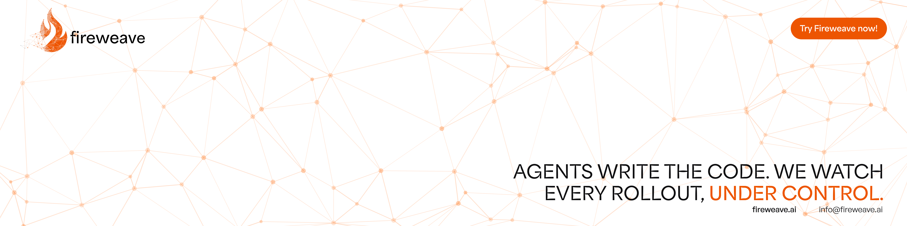

<a href="https://app.fireweave.ai">
  <picture>
    <source media="(prefers-color-scheme: dark)" srcset="https://raw.githubusercontent.com/FireWeave-HQ/fireweave-sdk/main/.github/assets/banner-dark.png">
    <source media="(prefers-color-scheme: light)" srcset="https://raw.githubusercontent.com/FireWeave-HQ/fireweave-sdk/main/.github/assets/banner-light.png">
    
  </picture>
</a>

<p align="center">
  <a href="https://crates.io/crates/fireweave"></a>
</p>

**Fireweave is the AI release engineer for teams shipping with coding agents.** Every change rolls out behind a control point, one step at a time, with guardrails watching real users — and if something breaks, Fireweave pauses or rolls it back before most users ever see it. It's the only way to ship as fast as your agents write code, without the fear of breaking production.

## Quick start · Rust

```bash
cargo add fireweave
```

```rust
use fireweave::{
    init_fireweave, EvaluationContext, InitOptions, RegisterTargetOptions, TargetKind,
};

fn main() -> Result<(), Box<dyn std::error::Error>> {
    let client = init_fireweave(InitOptions::remote(
        std::env::var("FW_PROJECT_API_KEY")?,
        std::env::var("FW_API_URL")?,
    ))?;

    // Once per login: the facts your targeting rules match on.
    let target = RegisterTargetOptions {
        kind: Some(TargetKind::User),
        properties: Some([("plan".into(), "pro".into())].into_iter().collect()),
        ..Default::default()
    };
    client.register_target("user_42", Some(&target));

    let ctx = EvaluationContext::new().with_targeting_key("user_42");
    let enabled = client
        .control_points
        .get_boolean_value("new-checkout", false, Some(&ctx));
    println!("new-checkout: {enabled}");

    client.shutdown();
    Ok(())
}
```

## Learn more

[Concepts](https://github.com/FireWeave-HQ/fireweave-sdk/blob/main/docs/concepts.md) · [Identity](https://github.com/FireWeave-HQ/fireweave-sdk/blob/main/docs/identity.md) · [Testing](https://github.com/FireWeave-HQ/fireweave-sdk/blob/main/docs/testing.md) · [Troubleshooting](https://github.com/FireWeave-HQ/fireweave-sdk/blob/main/docs/troubleshooting.md) · [All SDKs](https://github.com/FireWeave-HQ/fireweave-sdk#quick-start)

## License

[MIT](https://github.com/FireWeave-HQ/fireweave-sdk/blob/main/LICENSE)
